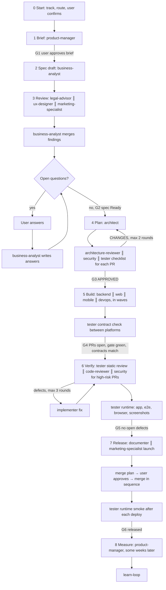

# Workflow

This document is a map of the workflow. It tells which agent runs in which phase, when
the orchestrator calls it, and which skills each agent and the orchestrator use.

The details are in the source files. If this document and a source file do not agree,
the source file is correct:

- [skills/sdd-orchestrator/SKILL.md](skills/sdd-orchestrator/SKILL.md) — tracks, phases,
  gates, route, dispatch, merge, model and effort
- [skills/sdd-orchestrator/contract.md](skills/sdd-orchestrator/contract.md) — rules for
  all agents, file owners, IDs, report format
- [agents/](agents/) — the rules of each role
- [skills/](skills/) — the procedures

## Two ways to work

| Way | When to use it | How to start |
|-----|----------------|--------------|
| **Orchestrator** | A feature from an idea to a PR, with many roles | Ask Claude to deliver the feature with SDD. The main session loads `sdd-orchestrator`. |
| **Skills only** | One step of the workflow, without agents | Ask for the step, for example "analyze these requirements" or "review PR 42". Claude loads the skill. |

## Tracks

The orchestrator selects one track before the first dispatch. Each track uses only the
phases that it needs.

| Track | When | Flow |
|-------|------|------|
| `bugfix` | The current behavior is wrong, and the correct behavior is known. | implementer (`bugfix`: failing test → cause → fix → regression test) → code-reviewer ║ tester (`runtime`) → merge |
| `small` | One platform, one PR. No new entity, no migration, no contract change, no new dependency. | business-analyst (`short`) → tester (`checklist`) → implementer → tester (`static-review`) ║ code-reviewer → documenter → merge |
| `feature` | All other work. | the full pipeline below |
| `epic` | More than one feature, or more than six tasks for one platform. | one brief with a list of features, then the `feature` track for each feature |

If a `small` or `bugfix` task needs a contract change, a new entity or a migration, the
implementer stops, and the orchestrator changes the track to `feature`.

## Pipeline of the feature track

`║` shows agents that run in parallel. `G1`–`G6` are gates. The orchestrator does not
start the next phase before the gate is complete.



The researcher can run in each phase, when an agent asks for research.

## Phases

| Phase | Agents | Input | Output | Gate |
|-------|--------|-------|--------|------|
| 0 Start | orchestrator | user request | `status.md`, track, route | user confirms the route |
| 1 Brief | product-manager | user request | `brief.md` | G1 — user approves the brief |
| 2 Spec | business-analyst (`draft` or `short`) | `brief.md` or user request | `spec.md` (Draft) | — |
| 3 Review | legal-advisor ║ ux-designer ║ marketing-specialist, then business-analyst (`merge`, `answers`) | `spec.md` | `legal.md`, `ux.md`, `marketing.md`, `spec.md` | G2 — spec is Ready for development |
| 4 Plan | architect, then architecture-reviewer ║ security (`plan`) ║ tester (`checklist`) | `spec.md`, `ux.md`, `legal.md` | `plan.md`, `tasks.md`, ADRs, `test-checklist-<pr-key>.md` for each PR, `plan-review.md`, `security.md` | G3 — plan APPROVED |
| 5 Build | backend ║ web ║ mobile implementers ║ devops, then tester (`contract`) | `plan.md`, `tasks.md`, `test-checklist-<pr-key>.md` | one branch and one PR for each PR key, `contract-check.md` | G4 — PRs open, gate green, contracts match |
| 6 Verify | tester (`static-review`) ║ code-reviewer ║ security (`pr`), then implementers (`fix`), then tester (`runtime`) | PR diffs, running application | marks in `test-checklist-<pr-key>.md`, `static-review-<pr-key>.md`, PR comments, screenshots | G5 — no open defects |
| 7 Release | documenter ║ marketing-specialist (`launch`), then orchestrator (merge), then tester (`runtime` after deploy) | final PRs | project docs, docs PR, launch plan, merged PRs, `release-check.md` | G6 — released, checks after deploy pass |
| 8 Measure | product-manager (`measure`) | metric of `brief.md`, real data | `measure.md`, proposals | — |

## Merge and release

The orchestrator merges only after the user approves the merge plan. The plan comes
from the Release sequence of `plan.md`:

1. The PRs that give a contract go first, for example backend and devops.
2. The PRs that use the contract go after the deploy of the PR that gives it.
3. The docs PR goes last.
4. A contract change that is not backward compatible needs a feature flag, or support for
   the old and the new version at the same time.

After each deploy, the tester runs the P1 smoke checks. If a check fails, the merge plan
stops, and the orchestrator proposes a rollback to the user.

## Change requests

If the user changes a requirement after G2, the orchestrator:

1. stops new waves
2. dispatches business-analyst in mode `change`, which gives a `CR` ID and the changed IDs
3. finds the affected tasks, checks and PRs from the IDs in `tasks.md` and the test
   checklists
4. shows the effect to the user, and continues after approval
5. dispatches again only the affected agents

All artifacts of a feature are in the feature folder, for example
`docs/features/<feature-slug>/`.

## Project docs

The skills and the agents use this structure in a project. Copy it from
[templates/](templates/):

```text
PRODUCT.md                 goal, users, scope, roadmap of the product   (product-manager)
docs/
  tech/                    architecture and technical questions
    architecture.md        components, data flow, data model           (documenter)
    api.md                 endpoints and errors                        (documenter)
    configuration.md       environment variables and flags             (documenter)
    adr/                   architecture decision records               (architect)
    runbooks/              procedures for repeated failures            (learn-loop)
  features/                product descriptions and specs of features
    README.md              index of features with status               (documenter)
    <feature-slug>/        one folder for each feature
      README.md            the feature as it works now                 (documenter)
      brief.md, spec.md, ux.md, plan.md, test-checklist-<pr-key>.md, ...  (see contract.md)
.github/workflows/
  security.yml             secrets, workflow security, dependency review    (devops)
```

## When the orchestrator calls each agent

| Agent | The orchestrator calls it when | Modes |
|-------|--------------------------------|-------|
| product-manager | the problem, the goal or the scope is not clear, the feature is a new product area, or the work is an epic. Always in phase 8. | `brief`, `fix`, `measure` |
| business-analyst | always, except the `bugfix` track. Also for each change request. | `draft`, `short`, `merge`, `answers`, `gaps`, `change` |
| legal-advisor | the feature touches personal data, payments, consent, minors, licenses, external terms or a regulated area | `review` |
| ux-designer | the feature changes the UI or text that users see | `review` |
| marketing-specialist | users see the feature, or it changes acquisition, activation, conversion, prices, public pages or store listings | `review`, `launch` |
| researcher | an agent asks for research that needs more than a few web searches | — |
| architect | the `feature` and `epic` tracks. A short plan for a simple feature. | `plan`, `fix` |
| architecture-reviewer | the feature adds an entity or a migration, changes a contract, touches more than one repository, needs an ADR, or touches security, payments or personal data | `review`, `re-review` |
| security | the feature touches authentication, sessions, permissions, payments, personal data, administrator access or a public entry point. In phase 6, only for high-risk PRs. | `plan`, `pr` |
| backend-implementer | `tasks.md` has `backend` tasks, or a backend bug | `build`, `fix`, `bugfix` |
| web-implementer | `tasks.md` has `web` tasks, or a web bug | `build`, `fix`, `bugfix` |
| mobile-implementer | `tasks.md` has `mobile` tasks, or a mobile bug | `build`, `fix`, `bugfix` |
| devops | the feature needs infrastructure, CI, deploy, environment variables or secrets | `build`, `fix`, `bugfix` |
| tester | always, except `contract` (only with more than one platform) and `runtime` (only for 🔍 checks, UI changes, bugs that a person can see, and after each deploy) | `checklist`, `static-review`, `contract`, `runtime` |
| code-reviewer | always, for each PR | `review`, `re-review` |
| documenter | the `feature` and `epic` tracks, after G5. The `small` track, if users see the change. | `feature`, `sync` |

A high-risk PR changes authentication, sessions, permissions, payments, personal data,
administrator access, migrations, CI or deploy, or more than 800 lines of source code.

## Skills that each agent uses

All agents read [contract.md](skills/sdd-orchestrator/contract.md) first. All agents use
`writing-style` for English text.

| Agent | Skills |
|-------|--------|
| business-analyst | `requirement-analyze` |
| ux-designer | `localization` |
| architect | `ponytail` |
| tester | `test-checklist` (mode `checklist`), `static-review` (mode `static-review`), `localization` (mode `runtime`). In mode `runtime` also the `run` skill or a browser tool, if available. |
| backend, web and mobile implementers, devops | `ponytail`. `localization` if the task changes text that users see. |
| code-reviewer | `pr-review` |
| product-manager, legal-advisor, marketing-specialist, researcher, architecture-reviewer, security, documenter | only `writing-style`. Their procedure is in the agent file. |

Agents read skills from `~/.claude/skills/<name>/SKILL.md`. Thus, the skills must have
links in `~/.claude/skills/`.

## Skills that the orchestrator uses

| Skill | When |
|-------|------|
| `sdd-orchestrator` | the full pipeline |
| `learn-loop` | one time in phase 7, for the full feature |
| `schedule` | in phase 7, to schedule phase 8 at the measure date |
| `writing-style` | for `status.md` and the report |

The orchestrator also uses AskUserQuestion to ask the questions of the agents in one
group.

## Skills without agents

You can use each skill alone, without the orchestrator:

| Skill | Use it when you want to |
|-------|-------------------------|
| `requirement-analyze` | analyze requirements and make a spec with questions |
| `test-checklist` | make a test checklist from a spec |
| `static-review` | examine a diff against the test checklist and mark the checks that are done |
| `pr-review` | review a PR of a colleague and post inline comments |
| `learn-loop` | save the lessons of a task |
| `memory-gc` | make the memory small and correct, about one time each month |
| `ponytail` | get the most simple solution for a coding task |
| `localization` | write or show text in more than one language |
| `writing-style` | write or examine English text in ASD-STE100 |

The skills make a chain. Each skill can use the output of the skill before it:

```text
requirement-analyze → test-checklist → static-review → pr-review → learn-loop
     spec.md          test-checklist.md   [x] marks      PR comments   memory
```

The spec gaps that `test-checklist` and `static-review` find go back to
`requirement-analyze` as new questions.

## Hooks

| Hook | Event | What it does |
|------|-------|--------------|
| `learn-reminder.sh` | `SessionStart`, `Stop` | If the session changed a git ref, reminds you to use `learn-loop`. |
| `guard-large-image.sh` | `PreToolUse` (`Read`) | Blocks a Read of an image that is larger than 300 KB. |

## Model and effort

The orchestrator selects the model and the effort for each dispatch from the complexity of
the task. The full table is in [sdd-orchestrator](skills/sdd-orchestrator/SKILL.md), in
the section "Model and effort".

| Complexity | Model · effort |
|------------|----------------|
| Mechanical | `haiku` · `low` |
| Usual | `sonnet` · `medium` |
| Complex | `sonnet` · `high` |
| Critical | `opus` · `high` |
| Very hard | `opus` · `xhigh` |

## Where to ask the user

The agents cannot talk to the user. The orchestrator stops for the user at these points:

- the route and the permission for PR comments (phase 0)
- the brief (G1)
- the blocking and important questions of the spec (phase 3)
- the plan after two rounds with `CHANGES` (phase 4)
- each devops action that costs money, deletes data or is hard to reverse
- open defects after three fix rounds (phase 6)
- the merge plan (phase 7). The orchestrator merges only after the user approves it.
- a rollback after a failed check after deploy (phase 7)
- the effect of a change request
- the proposals of the measure (phase 8)
